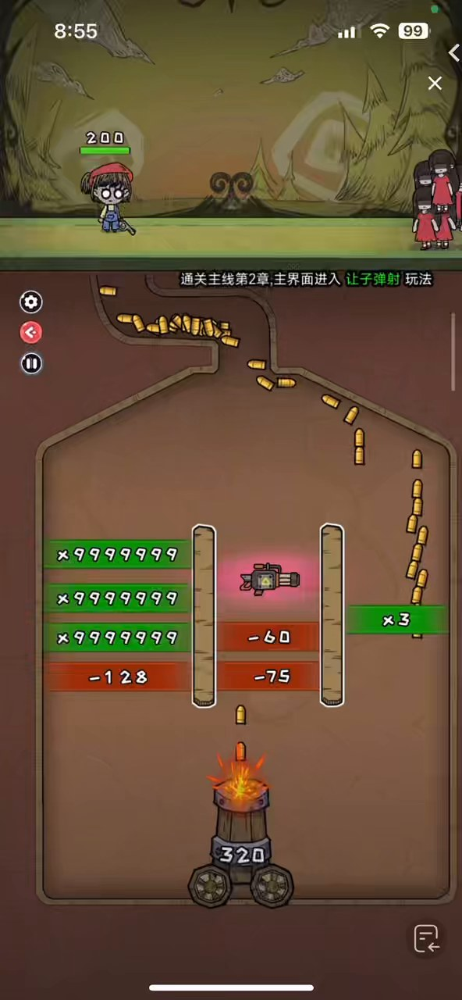
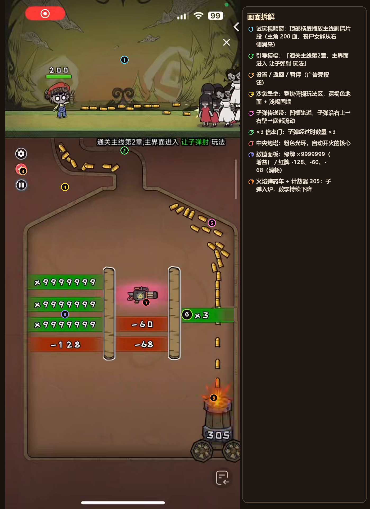
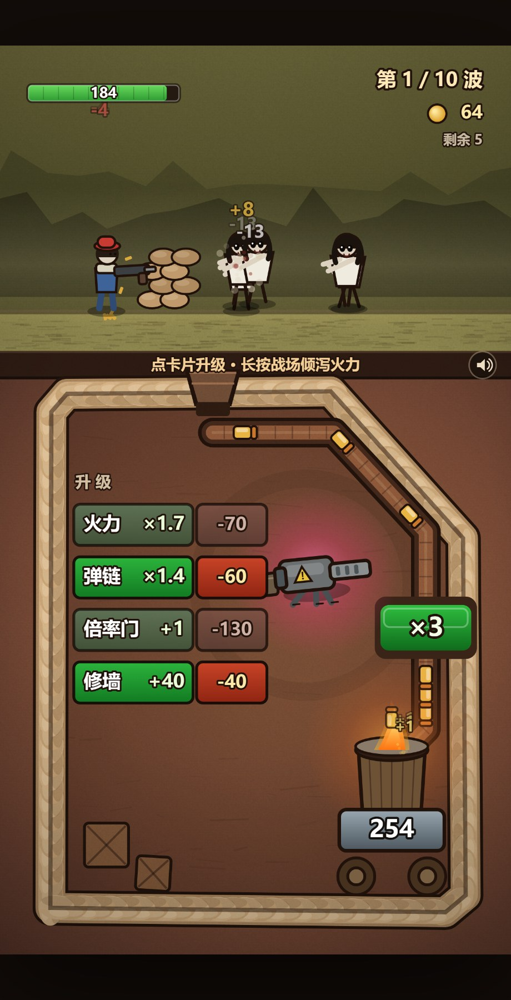
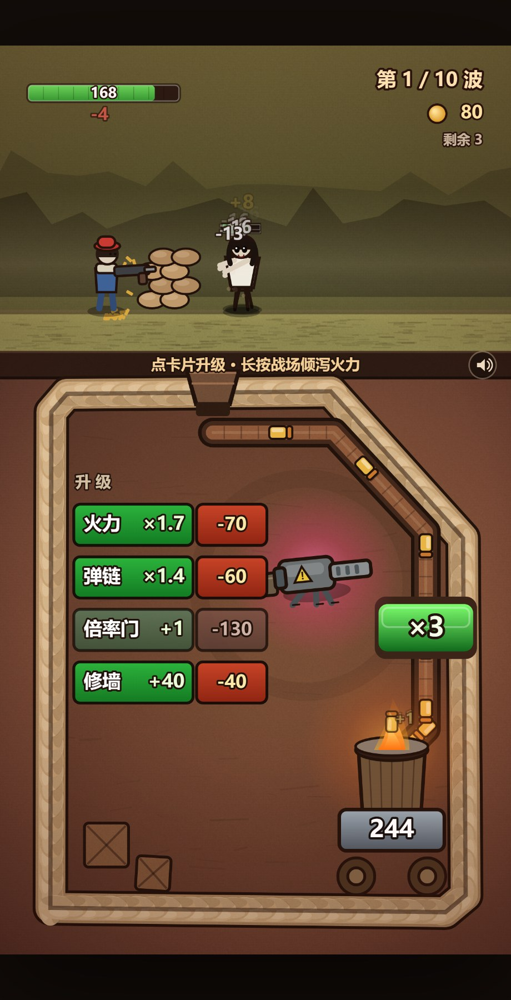
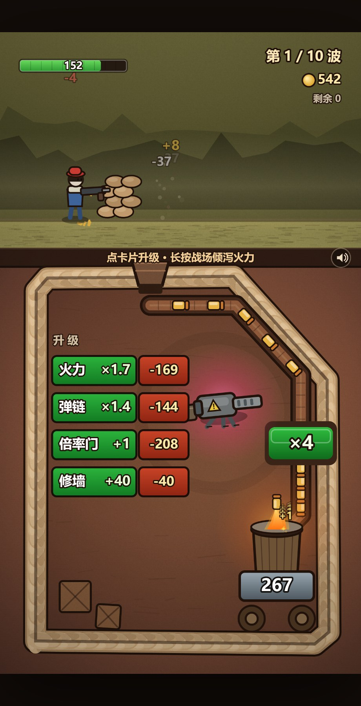

# 《让子弹射》玩法拆解与 H5 复刻方案

> 素材：`D:\Download\b4f8b35234421ecad8e58b8127fa7fd0.mp4`（抖音试玩广告录屏，6.77 秒）
> 产出：本文档 + 标注图 `assets/annotated-factory.png` + 可运行原型 `prototype.html`
> 说明：本文所有结论按 **可确证 / 合理推断 / 设计决策** 三档标注，避免把猜测写成事实。

---

## 1. 素材事实

| 项 | 值 |
| --- | --- |
| 时长 | 6.767 s |
| 分辨率 | 592 × 1280（竖屏，比例 ≈ 0.4625） |
| 帧率 / 帧数 | 30 fps / 201 帧 |
| 视频编码 | HEVC (H.265)，码率 ≈ 640 kbps |
| 音频 | AAC 单声道 44.1 kHz |
| 文件大小 | 584 KB |
| 画面内容 | 手机录屏：状态栏（8:55、信号、98% 电量）+ 抖音试玩广告容器 |

一段 6.77 秒的素材里其实叠了 **三层信息**，拆解时必须分开看：

1. **系统层**：状态栏、底部 Home 指示条、右侧细滚动条。
2. **广告容器层**：左侧三个圆形按钮（设置 / 返回 / 暂停，y ≈ 425–500）、视频窗右上角的关闭 `×`。
3. **内容层**：上半屏是主线游戏的竖屏视频窗，下半屏是可玩小游戏「让子弹射」。



---

## 2. 上半屏：主线视频窗（钩子）

宽度占满，高度约占屏幕 23%（y ≈ 0–290 / 1280）。

**可确证**

- 主角：小男孩，红色鸭舌帽、蓝色背带裤、手持步枪，头顶 `200` + 绿色血条。
- 敌人：一群穿白裙 / 红裙的「女学生」丧尸，黑长直发、全黑眼窝、惨白皮肤，从画面右侧成排走入。
- 地面：土黄色路面，散落大量**黄铜弹壳**（从主角脚下向右排成弧线）。
- 背景：橄榄绿森林、山影、雾；中景有一截巨大树桩；整体棕褐 + 橄榄绿的低饱和配色。
- 6.77 秒内敌人只前进了一小段（慢速压迫感），血条与 `200` 始终不变。

**合理推断**

- 这是「主线第 2 章」的真实战斗画面，用来做**题材背书**：先让你看到正片的画面质量，再把你丢进下方的小游戏。
- `200` 是主角血量，绿条是血条；弹壳说明主角一直在射击（弹壳即「子弹」主题的视觉锚点）。

**对 H5 的启示**：上方窗口承担「我是谁、在打谁」，下方承担「我怎么玩」。复刻时可以把它压成一条 16:9 / 4:3 的剧情条，或者直接用同风格插画替代（版权原因不能直接搬运素材）。

---

## 3. 下半屏：可玩小游戏「让子弹射」

### 3.1 横幅

一行深色半透明条，文字：

> 通关主线第2章,主界面进入 **让子弹射** 玩法

其中「让子弹射」为绿色高亮。作用是把「看视频」和「玩小游戏」在文案上缝起来。

### 3.2 场景（俯视工厂）



| 元素 | 位置（592×1280 坐标系） | 描述 |
| --- | --- | --- |
| 沙袋围墙 | 环绕画面 1/6 ～ 5/6 | 米黄色（≈ `#c2a077`）粗边圆角框，右上角切一刀斜角；深棕描边 ≈ `#241610` |
| 地面 | 墙内 | 红棕色（≈ `#784830`），有细微划痕、油渍 |
| 传送带 | 从左上进入 → 沿上墙向右 → 切角下行 → 沿右墙向下 | 嵌在墙体里的一条凹槽，黄铜子弹（≈ `#e6be5a`，铜色弹头）顺时针流动 |
| 倍率门 | x 450–561，y 776–809 | 绿色（≈ `#009000`）横牌，白字 `×3`，骑在传送带上 |
| 炮塔 | 约 (300–410, 725–800) | 深灰机枪，背后一团**品红 / 玫红径向光晕** |
| 刻度木柱 | x ≈ 245–270 与 405–430，y ≈ 670–905 | 两根浅木色圆角立柱，带等距刻度线，像「标尺」，分列炮塔两侧 |
| 绿色数值牌 ×3 | x 66–233，y 692–832 | 三块叠放的绿牌，白字 `×9999999` |
| 红色数值牌 | x 66–233，y ≈ 832–870 | 红牌 `-128` |
| 中央红牌 ×2 | x 300–408，y 796–885 | 上 `-60`，下 `-68`（数值会变，见 3.3） |
| 炉车 | 底部居中，直径 ≈ 150 | 木桶 + 大火 + 灰色装甲牌（数码管 `320`）+ 两只轮子 |
| 悬浮子弹 | 火焰正上方 | 一颗子弹悬在火苗上，随火焰轻微浮动 |

### 3.3 动态观测（逐帧对比得到）

- **炉车计数持续下降**：`320 → 290 → 269`，约 **7.5 / 秒**，线性、无回弹。这是全片唯一明确变化的数值。
- **传送带子弹源源不断**：从左上角涌入，经过 `×3` 门后变成三倍密度，继续向右下流走。
- **中央红字在变**：`-75 → -68 → -67 → -64 → -63`，向 0 靠近（绝对值变小）。
- **`×9999999`、`-128`、`-60`、`×3` 全程不变**。
- **相机**：缓慢拉远约 8%，同时画面整体右移（炉车从「居中」变成「偏右下」）。

### 3.4 三层结论

| 档位 | 内容 |
| --- | --- |
| **可确证** | 所有元素的**位置、颜色、文字、数值**；`320 → 269` 的单调下降；`×3` 牌；三块 `×9999999`；品红光晕；两根刻度柱；火焰与轮子；横幅文案；上半屏 `200` 血条与女学生丧尸 |
| **合理推断** | 传送带＝**弹药供给**（子弹流进炉车 → 计数增加供给）；`×3` 门＝**倍率**（一发变三发）；红色数字＝**价格 / 消耗**；绿色牌＝**可重复升级项**（`9999999` 是「无限次」的夸张表达）；炮塔自动开火并**消耗计数**；中央闪烁的红字是某种**动态消耗/倒计时**；上半屏是主线正片素材，用来做题材背书 |
| **设计决策**（本方案新增，非原片事实） | 把装饰性数字**规整成真实经济**；补上「敌人」这一威胁维度；补上波次、金币、击杀奖励；补上「长按倾泻火力」的主动操作；补上修墙；把弹链与炉车**在画面上真正连起来**；10 波通关目标 |

原片的数值（`×9999999`、`-128`、`-75`）本质上**是装饰**：它们不构成可玩的数值系统，只是让你一眼觉得「这游戏很爽、数值很大」。这是试玩广告的常见套路——**用夸张数字制造点击欲望，而不是真的让你算数值**。H5 复刻不能照抄这层皮，必须补出真正的循环，否则 30 秒就腻。

---

## 4. H5 玩法设计

### 4.1 核心循环

```
[传送带产弹] --×倍率门--> [炉车：弹药 +N]
                              |
                              v
                      [炮塔自动开火：弹药 -1/发]
                              |
              +---------------+----------------+
              |                                |
        [击杀丧尸 → 金币]              [丧尸摸墙 → HP -N]
              |                                |
              +-----------> [买升级] <----------+
                              |
                   火力↑ / 弹链↑ / 倍率↑ / 修墙
```

一句话：**子弹从上面流下来，炮塔拿它去打人，打死的钱再买更多子弹——弹链速度就是你的 DPS 上限。**

### 4.2 三个资源，互相牵制

| 资源 | 来源 | 消耗 | 作用 |
| --- | --- | --- | --- |
| **弹药** | 传送带 → 炉车（受倍率门加成） | 每次开火 -1 | 没弹药 = 不输出 |
| **金币** | 击杀丧尸 | 买四张升级卡 | 唯一的成长途径 |
| **HP（墙）** | 初始 200，修墙 +40 | 丧尸摸墙 | 归零即失败 |

关键设计：**弹药收入 ≈ 自动开火的消耗**（略低于），所以「站着不动」是缓慢亏空，玩家必须靠升级弹链把收入拉起来；而「长按倾泻」是**用弹药换爆发**——这就是操作层。

### 4.3 数值表（原型实装值）

| 项 | 初值 | 说明 |
| --- | --- | --- |
| HP | 200 | 与广告里的 `200` 对齐 |
| 弹药 | 260 | 炉车数码管显示 |
| 金币 | 40 | 开场能买一张卡 |
| 伤害 | 13 | 每次命中 |
| 自动射速 | 0.32 s / 发（≈ 3.1 发/秒） | 炮塔 |
| 长按射速 | 0.13 s / 发（≈ 7.7 发/秒），伤害 ×1.25 | 倾泻模式 |
| 弹链间隔 | 0.95 s / 发 | 升级 ×0.7 |
| 倍率门 | ×3 | 每级 +1 |
| 波次 | 10 波 | 第 10 波出 Boss |
| 丧尸 | 女学生 96 HP / 72 px/s / 4 dmg；快速 60/110/3；坦克 260/50/8；Boss 1400/32/16 | 每波 HP ×(1+0.5×(波-1)) |
| 每波数量 | 6 + 2×波 | 出怪间隔 0.95 − 0.03×波（下限 0.5 s） |
| 击杀奖励 | 6 + 2×波 | Boss 额外 +120 |
| 卡价 | 火力 70 / 弹链 60 / 倍率门 130 / 修墙 40 | 每次购买后 ×1.55 / ×1.55 / ×1.6（修墙不变） |

**经济自检**：弹链每 0.95 s 产 1 发，过 `×3` 门后合计 **3 ÷ 0.95 ≈ 3.16 发/秒**，自动开火 **3.1 发/秒**——几乎持平，容错极小；玩家一旦长按（7.7 发/秒），弹药以 ≈4.5 发/秒的速度掉，260 发 ≈ 58 秒的爆发窗口。这就是「升级弹链」的动机。

### 4.4 交互

| 操作 | 位置 | 效果 |
| --- | --- | --- |
| 点卡片 | 下半屏左侧四张牌 | 购买对应升级 |
| 长按 | 上半屏战场任意位置 | 倾泻火力（射速↑、伤害 ×1.25） |
| 松手 | — | 回到自动射速 |
| 结算 | 覆盖层按钮 | 重开一局 |

移动端全部用 `pointerdown / pointerup`，不依赖 hover；`touch-action: none` 防止滚动干扰。

### 4.5 视觉规范

- **逻辑分辨率 720 × 1280（9:16）**，等比缩放居中：`width: min(100vw, 56.25dvh); aspect-ratio: 9/16;`（`56.25dvh = 100dvh × 9/16`，保证矮屏也不裁切）。
- 分区：战场 `0–430`，分割条 `430–470`，工厂 `470–1280`。
- 调色板（取自原片）：

| 名称 | 值 |
| --- | --- |
| 描边墨色 | `#20120b` |
| 战场天空 | `#7b7642 → #4a4726` |
| 土路 | `#918a52` |
| 工厂地面 | `#8a5a3d → #4f3026` |
| 沙袋 | `#c9a77c` |
| 黄铜弹体 | `#e8b545`，弹头 `#c9772c` |
| 升级绿 | `#1fa02e` |
| 价格红 | `#b8371f` |
| 火焰 | `#ff8a1f → #ffd24a` |

- 字体：`system-ui / Microsoft YaHei / PingFang SC`，全部文字带深色描边（`lineWidth ≈ 0.17 × fontSize`），保证在噪点背景上可读。
- 手绘感的做法：墙线用**同一折线以不同线宽/透明度叠画 3 遍**（模仿马克笔重描），边缘点加 ±2 px 抖动；沙袋用无缝重叠的椭圆堆叠（不带单袋描边）；最后叠 160×160 纸纹 tile + 径向暗角。

---

## 5. 原型实现

单文件、零外部依赖：`docs/bullet-factory/prototype.html`（约 1.3k 行，Canvas 2D + WebAudio）。

### 5.1 结构

| 段 | 内容 |
| --- | --- |
| 0–1 | 画布/常量、`mulberry32` 随机、`rr` 圆角矩形、`text` 描边文字、`walk`/`makePath`/`posAt` 折线采样 |
| 2 | 场景几何：`WALL_PTS`（沙袋墙折线）、`BELT`（传送带路径）、`GATE_D`（倍率门在路径上的位置）、`CART` |
| 3 | `BACK`：把天空、山影、雾、土路、分割条、地面、沙袋墙、传送带凹槽、料斗、木箱、纸纹、暗角**一次性预渲染**到离屏 canvas（2× 分辨率），每帧只 `drawImage` |
| 4–6 | 状态、WebAudio 音效、粒子/飘字 |
| 7–8 | 波次、生成、射击、购买 |
| 9–11 | 输入、更新、绘制（`drawGate / drawCart / drawTurret / drawCards / drawZombie / drawHero / drawBarricade / drawHUD / drawOverlay`） |
| 12 | 主循环（`dt` 上限 50 ms，切后台不炸） |

### 5.2 已实装

- 弹药闭环：料斗 → 传送带 → `×3` 门（一发变三发）→ 炉车 +1 → 炮塔消耗
- 10 波、4 种丧尸、Boss、金币、四张升级卡、价格递增
- 伤亡反馈：受击红屏、震屏、弹壳抛射与落地、飘字、击杀粒子
- 胜负判定与重开
- 分割条右侧的静音按钮（点一下关音效，再点恢复）

### 5.3 截图

| 自动开火 9 秒（尸潮压到墙前） | 长按倾泻 2 秒 | 升满后（×4 门、37 伤害） |
| --- | --- | --- |
|  |  |  |

### 5.4 验证方式

用仓库里已有的 Playwright（`channel: 'msedge'`）跑无头冒烟，脚本在 `verify.mjs`：

| 断言 | 结果 |
| --- | --- |
| 首屏 / 长按 / 升满三种状态截图 | 生成 `shot-1/2/3.jpg` |
| 静音按钮点击 → `muted` 切换 | true → false ✓ |
| 金币不足时点「火力」卡 | 金币不变（40 → 40）✓ |
| `pointerdown` → `holding === true`，`pointerup` → `false` | ✓ |
| 9 秒自动开火后 | 第 1 波进行中、墙已被啃（HP 18x）、已有击杀与金币入账 |
| 连买两次火力 + 两次弹链 + 一次倍率门 | 伤害 13 → 37，门 ×3 → ×4 ✓ |
| 控制台 | **0 条 error / pageerror** |

另有一次 45 秒长跑（`window.__game.state` 轮询）：第 1 波清空 → 自动进入第 2 波，击杀 / 金币 / 弹药连续变化，HP 归零后 `over === 'lose'`，覆盖层可重开。

调试钩子 `window.__game = { state, buy, startWave }` 保留在原型里，方便后续自动化与数值调试。

### 5.5 明确没做

- 没有美术资源（全部程序化绘制）、没有背景音乐、没有存档/排行榜/元商店
- 没有做横屏适配、没有做低端机降帧
- 数值只做了「能玩通第 1–2 波」的手感验证，10 波曲线未做完整压测

---

## 6. 接入 lite-joy（已完成）

原型不是直接塞进 SFC，而是拆成「引擎 + 页面外壳」两层，和仓库既有约定保持一致。

| 文件 | 作用 |
| --- | --- |
| `src/games/ammo/engine.ts` | 引擎：纯 Canvas 2D，逻辑分辨率 720×1280，导出 `createAmmoGame()` |
| `src/components/AmmoGame.vue` | 页面外壳：返回按钮、开始页、等比舞台，负责创建/销毁引擎 |
| `src/App.vue` | `view` 增加 `'ammo-game'`，首页「小游戏」区加第三张卡片 |
| `public/ammo-cover.jpg` | 开始页横幅（从原型截图裁出的战场区，920×600） |
| `README.md` | 游戏列表加一行 |

引擎接口：

```ts
const game = createAmmoGame(canvas, { onState?: (s: AmmoState) => void })
game.start()      // 启动主循环（幂等）
game.restart()    // 重开一局
game.toggleMute() // 静音开关
game.getState()   // 状态快照
game.destroy()    // 停循环 + 解绑全部监听 + 关闭 AudioContext
```

和原型阶段的差异：

- **缩放交给 CSS**：画布内部按 `devicePixelRatio`（≤2×）放大，显示尺寸用 `width: min(100cqw, 56.25cqh)` + `aspect-ratio: 9/16`，容器查询保证「宽高都不溢出且不变形」；指针坐标用 `getBoundingClientRect()` 反算，和缩放解耦。桌面 1280×800 实测画布 408.9×727、手机 390×844 实测 372×661，比例都是精确 9:16。
- **常量收进闭包**：`W/H`、配色 `C`、几何点表都在 `createAmmoGame` 内部，多实例不会串味。
- **监听可回收**：指针 / 窗口 / `blur` 监听都挂在 `AbortController.signal` 上，`destroy()` 一次解绑；`requestAnimationFrame` 与 `AudioContext` 同步清理。
- **调试钩子**：不再用原型的 `window.__game`，改为 DEV 下的 `window.__ammoGame`，生产构建被 `import.meta.env.DEV` 剔除。
- **沙袋墙改成横放两层**：原型里是 2 宽 4 高的「石堆」，接入时按原片改成横躺错缝的墙。

验证：`vue-tsc -b`、`vite build` 均通过；`docs/bullet-factory/e2e-ammo.mjs` 在 dev（5199）与 preview（5201）两端跑通——首页卡片、开始页、开局、长按 `holding` 翻转、金币与弹药变化、控制台 0 错误。

---

## 7. 风险与取舍

| 风险 | 说明 | 应对 |
| --- | --- | --- |
| **题材敏感** | 原片是「打女学生丧尸」，直接照搬放在公开站点上不合适 | 复刻只保留**机制**，角色改成无性别「小黑怪 / 机械靶」，或做一套皮肤开关 |
| **版权** | 原片的美术、音乐、文案都不可直接使用 | 全部程序化重绘（已按此实现），文案另写 |
| **竖屏独占** | 桌面端两侧留黑边 | `#stage` 已按 `min(100vw, 56.25dvh)` 居中，桌面加圆角与阴影 |
| **数值装饰化** | 照抄 `×9999999` 会毁掉可玩性 | 已改为真实经济（见 4.3） |
| **性能** | 每帧 ~20 颗子弹 + ~200 粒子 + 弹壳 | 背景预渲染；弹壳按 `slice(-110)` 截断，粒子按寿命回收，中端机可稳 60 fps |

---

## 8. 附录

### 8.1 文件清单

```
docs/bullet-factory/
├─ README.md                  # 本文
├─ prototype.html             # 可玩原型（直接双击打开）
├─ verify.mjs                 # 原型冒烟脚本（截图 + 交互断言）
├─ e2e-ammo.mjs               # 接入后的 Playwright 验证（dev / preview 均可跑）
├─ e2e-cards.mjs              # 升级卡命中测试（验证缩放后的坐标映射）
├─ make-cover.mjs             # 从运行中的页面抓图，重生成开始页横幅
└─ assets/
   ├─ annotated-factory.png   # 工厂场景标注图（9 处标注）
   ├─ frame-01-battle.jpg     # 原片开场帧
   ├─ frame-02-factory.jpg    # 原片中段帧
   ├─ frame-03-end.jpg        # 原片结尾帧
   ├─ shot-1.jpg              # 原型：尸潮压境
   ├─ shot-2.jpg              # 原型：长按倾泻
   └─ shot-3.jpg              # 原型：升级后
```

正式接入的代码不在这个目录，而在 `src/games/ammo/engine.ts` 与 `src/components/AmmoGame.vue`。

### 8.2 复现命令

```powershell
# 抽帧（30 fps 全抽）
ffmpeg -i b4f8b35234421ecad8e58b8127fa7fd0.mp4 -vsync 0 frames\f_%03d.png

# 拼接触图（每张 12 帧）
ffmpeg -i frames\f_%03d.png -vf "scale=148:-1,tile=12x6" sheets\sheet_%02d.png
```

```powershell
# 原型冒烟（仓库内已有 playwright）
node docs/bullet-factory/verify.mjs

# 接入后的端到端验证（先起 dev 或 preview）
$env:BASE_URL='http://localhost:5173/lite-joy/'
node docs/bullet-factory/e2e-ammo.mjs
```

### 8.3 关键坐标速查（592×1280）

| 元素 | x | y |
| --- | --- | --- |
| 视频窗 | 0–592 | 0–290 |
| 横幅 | 0–592 | 300–330 |
| 广告按钮列 | 22–66 | 425–500 |
| 沙袋墙外沿 | 55–545 | 340–1180 |
| `×3` 门 | 450–561 | 776–809 |
| 炮塔 | 300–410 | 725–800 |
| 左绿牌 ×3 | 66–233 | 692–832 |
| 左红牌 | 66–233 | 832–870 |
| 中央红牌 | 300–408 | 796–885 |
| 炉车 | 235–385 | 930–1180 |
