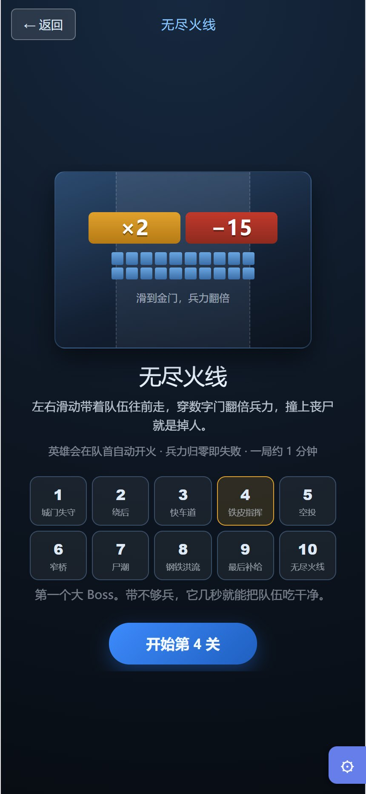
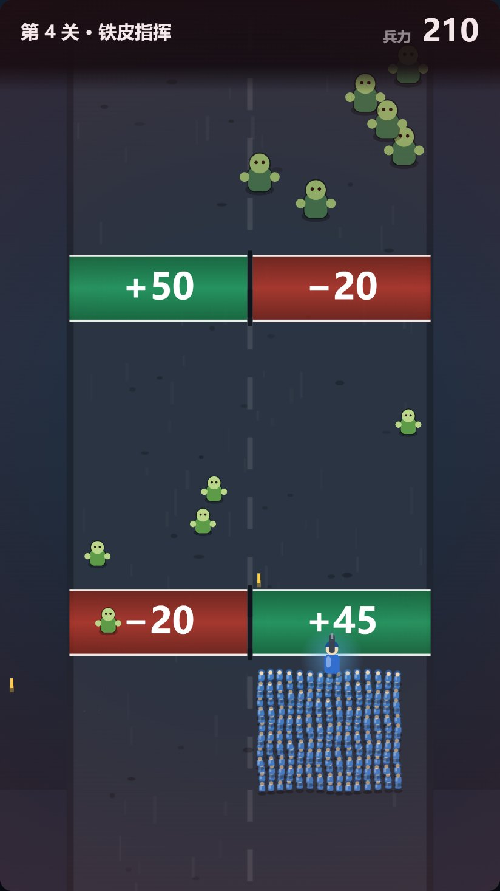
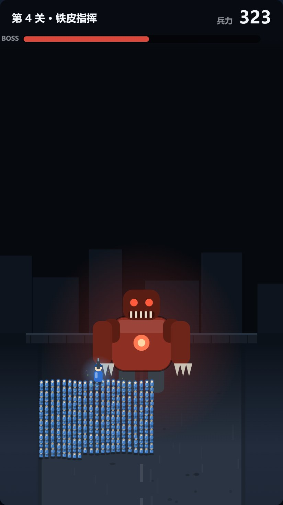

# 《无尽火线》玩法拆解与 H5 复刻

一款末日丧尸题材的「数字门」小游戏。玩家不操作英雄，只左右滑动带着一支队伍往前走：穿过绿门 / 金门让兵力变多，撞上丧尸就掉兵，最后用攒下来的兵硬扛 Boss。

本站实现在 `src/games/horde/`，入口卡片在首页小游戏区。

---

## 1. 素材事实

手头只有一支微信投放视频，逐帧拆过：

| 项 | 值 |
| --- | --- |
| 时长 / 分辨率 / 帧率 | 11.03 s，592×1280（9:16），30 fps |
| 编码 | HEVC + AAC，968 KB |
| 镜头切换 | 0 次（一镜到底的假玩法演示） |
| 音频 | 均值 −14.9 dB，峰值 −1.9 dB，铺满的合成音效 |
| 视频内嵌 UI | 广告 / 反馈 / 领取成功 / 上滑了解更多详情 / 跳转微信 |

内嵌 UI 的组合基本可以确认是穿山甲（字节系）激励视频落地，点进去会拉起微信小游戏。也就是说：**这支素材本身就是「广告套广告」**，前半段是钩子，后半段才是试玩。

游戏本体侧的事实：末日丧尸 + 数字门玩法，微信小游戏畅销榜 Top100 常客，著作权人北京星乐天空，出版上海双盟，运营上海沛炫，版号「国新出审〔2026〕713 号」。

> 结论：这是国内 SLG 厂商的标准买量打法——用「数字门 + 兵力翻倍」这种**一眼看懂、三秒出结果**的机制做钩子，真游戏是 SLG。本站复刻的只是钩子那一段。

## 2. 单局玩法（30–90 秒）

```
出发(少量兵) → 滑到门 → 兵力变化 → 丧尸来撞 → 再一个门 → … → Boss
```

- **操作只有一件事**：左右滑动，把队伍挪到赚的那一侧。
- **英雄自动开火**：队首的英雄不停打最近的丧尸，玩家管不着。
- **兵不是输出，是血条**：每个丧尸撞上来按只数扣兵，兵不还手。
- **门分三色**：绿 `+N`、金 `×N`、红 `−N`。
- **清完路程打 Boss**：Boss 站着不动，每秒吃掉固定兵力，同时自己的血条被英雄一点点磨掉。

| 出发 | 路上（两道门 + 尸群） | 打 Boss |
| --- | --- | --- |
|  |  |  |

### 2.1 设计地基：兵 = 血量 = 时间

这条是整个数值的地基，写引擎之前先定死的：

> **英雄是唯一 DPS，兵是唯一的血。**

推论直接决定了全部数值：

| 推论 | 结果 |
| --- | --- |
| Boss 战时长 = `boss.hp / heroDps` | 全局锁死 **16–18 秒**，跟关卡无关 |
| 进 Boss 需要的兵 = `boss.eat × 战时长` | 每关的「及格线」是可算的 |
| 兵再多也打不快 | 兵只买时间，不买输出 → 不存在「滚雪球无敌」 |
| 判定胜负只看一处 | 进 Boss 那一刻的兵力 vs 及格线 |

如果改成「兵也输出」，数值立刻失控：翻倍门会让 DPS 指数级上涨，Boss 血条要么秒杀要么打不动。**唯一的 DPS 必须只有一个来源。**

### 2.2 数字门的规则

门在实现上就是一段横跨路面的带子，队伍**队首**碰到时结算，按队伍中心 X 判定走哪条 lane：

| 形状 | 出现时机 | 用途 |
| --- | --- | --- |
| 两条 lane | 绝大多数 | 二选一，逼玩家做决定 |
| 一条 lane（全宽） | 中途补给 | 不给选择，单纯补兵 / 单纯惩罚 |

三条硬规则（写在 `levels.ts` 顶部注释里）：

1. **倍率门只放在前 3 个门**。那时候兵力基数还小（十几二十），乘完不炸；一旦放到后期，`×2` 直接让总数翻倍，Boss 就没法配平了。
2. **好门左右交替出现**。否则「不操作」就成了最优解——这是第一版真实踩到的坑：一开始所有好门都在左边，测试脚本全程不滑动反而通关最轻松。
3. **坏门只扣兵，不做 `÷N`**。60 秒的局，多一种规则就是多一层学习成本，收益抵不上。

### 2.3 难度曲线靠什么

不靠养成、不靠装备，只有四个旋钮：

- 丧尸密度与种类（girl / fast / tank）
- 门的加减值大小
- Boss 的 `eat`（每关单独配）
- 陷阱门扣多少

## 3. 数值表

全部关卡数据在 `src/games/horde/levels.ts`，手写、可改、类型护航。改数字不用动引擎。

| 关 | 名字 | 起始兵 | 英雄 DPS | Boss HP | 吃/秒 | 战时长 | 及格线 | 路长 |
| --- | --- | --- | --- | --- | --- | --- | --- | --- |
| 1 | 城门失守 | 10 | 100 | 1700 | 12 | 17.0s | 204 | 5420 |
| 2 | 绕后 | 10 | 105 | 1800 | 14 | 17.1s | 240 | 5520 |
| 3 | 快车道 | 12 | 110 | 1900 | 16 | 17.3s | 277 | 5620 |
| 4 | 铁皮指挥 ★ | 14 | 120 | 2000 | 20 | 16.7s | 333 | 5720 |
| 5 | 空投 | 14 | 130 | 2200 | 22 | 16.9s | 372 | 5720 |
| 6 | 窄桥 | 16 | 140 | 2400 | 24 | 17.1s | 411 | 5820 |
| 7 | 尸潮 | 16 | 150 | 2600 | 26 | 17.3s | 450 | 5820 |
| 8 | 钢铁洪流 ★ | 18 | 165 | 2900 | 30 | 17.6s | 528 | 5920 |
| 9 | 最后补给 | 20 | 180 | 3100 | 33 | 17.2s | 567 | 5920 |
| 10 | 无尽火线 ★ | 22 | 200 | 3400 | 36 | 17.0s | 612 | 6020 |

★ = 大 Boss 关（体型 1.35×，血条更宽，音效更低）。

「及格线」= `boss.eat × 战时长`，是进 Boss 段时至少要带到的兵。贪心走位实测进 Boss 的兵力：

机器人（只做「滑到赚的一侧」）逐关实测，全部通关：

| 关 | 及格线 | 进 Boss 兵力 | 富余 | 打完剩 | 一局耗时 |
| --- | --- | --- | --- | --- | --- |
| 1 | 204 | 382 | +178 | 176 | 60s |
| 2 | 240 | 424 | +184 | 179 | 61s |
| 3 | 277 | 456 | +179 | 177 | 61s |
| 4 | 333 | 487 | +154 | 149 | 62s |
| 5 | 372 | 529 | +157 | 147 | 66s |
| 6 | 411 | 567 | +156 | 146 | 63s |
| 7 | 450 | 566 | +116 | 115 | 63s |
| 8 | 528 | 605 | +77 | 74 | 64s |
| 9 | 567 | 639 | +72 | 52 | 64s |
| 10 | 612 | 699 | +87 | 72 | 65s |

读法：**富余 = 满分走位下的容错空间**。前五关富余 150+，相当于「可以大意三四道门」；第 8 关往后掉到 70–90，一道坏门的代价就接近半条命。这正是想要的曲线——前面的容错用来教学，后面的容错用来筛人。

### 3.1 调参口诀

```
Boss 战时长 ≈ boss.hp / heroDps        → 目标 16–18 秒
进 Boss 需要的兵 ≈ boss.eat × 17       → 及格线
好路线总兵力 ≈ 起始 × 6 + 各门加和 − 丧尸消耗
```

改完数字跑一遍 `npm run test:e2e:horde <关号>`，脚本会用贪心走位打完整局并打印进 Boss 兵力和剩余兵力。

## 4. 实现

### 4.1 结构

```
src/games/horde/
├─ levels.ts     # 10 关数据 + 类型 + getLevel()，零依赖，随便改
└─ engine.ts     # 纯 Canvas2D 引擎，导出 createHordeGame(canvas, opts)
src/components/HordeGame.vue   # Vue 壳：开始页 / 关卡选择 / 存档 / 生命周期
```

引擎不碰 Vue、不碰 DOM 事件之外的任何东西，和 `games/ammo` 保持同一套约定：

```ts
const game = createHordeGame(canvas, {
  level: 1,
  onState: (s) => {},   // 每 ~100ms 推一次快照
  onEvent: (e) => {},   // 'win' / 'lose'
})
game.start()
game.restart(2)   // 可选：换关重开
game.destroy()
```

### 4.2 引擎内部

`engine.ts` 按功能切了 11 段，段头有注释：

| 段 | 内容 |
| --- | --- |
| 1 | 常量与工具（`SPEED=118`、`CAM_LAG=300`、`HERO_INT=0.3`…） |
| 2 | 精灵预渲染：士兵 28×36、路面贴图 720×1280，全部程序化生成，无外部资源 |
| 3 | 音效：`beep()` 现场合成，不加载音频文件 |
| 4 | 运行态 `freshRun()` |
| 5 | 粒子 / 飘字 |
| 6 | 门结算 `applyGate()` |
| 7 | 丧尸波次 `feed()` / `spawnZed()` |
| 8 | 输入：pointer + ←→ + `R` 重开 |
| 9 | 更新 |
| 10 | 渲染 |
| 11 | 主循环 |

几个值得记的实现点：

- **队伍是无状态的**。只存一个 `troops` 数字，渲染时按人数算行列（3/5/8/11/15/18/21 列分档），上百人也不需要逐个体维护对象。上限 380 个身体，超了只画数字。
- **镜头固定滞后**：`camY = max(0, squadY - 300)`，队伍永远钉在屏幕下方约 980px 处，屏幕上方始终能看见未来 2–3 道门。
- **子弹带速度向量**，朝目标方向飞；Boss 战优先锁 Boss，否则锁最近的丧尸。
- **横移是插值**：`squadX += (targetX - squadX) * min(1, dt*14)`，滑一下半秒内到位，手感比直接跟随软，但不会拖沓。

### 4.3 输入映射

| 操作 | 行为 |
| --- | --- |
| 按住 / 拖动 | 队伍朝手指 X 平移（限位 246–474） |
| `←` `→` | 每次移 90px |
| `R` | 重开本关 |
| 结束页点击 | 赢了进下一关，输了重来 |

### 4.4 存档

`localStorage['lite-joy.horde.unlocked']` 存已解锁到第几关，默认 1。赢了自动 +1。隐私模式下读写失败会静默降级，不影响游玩。

## 5. 验证

```bash
npm run dev
npm run test:e2e:horde          # 第 1 关
node docs/horde/e2e-horde.mjs 8 # 指定关
```

脚本做的事：解锁全部关卡 → 进第 N 关 → 用一个只做「看远处那道门、滑到赚的一侧」的贪心机器人打完整局 → 断言

- canvas 真画出了东西（采样非透明像素）
- 控制台无报错
- 兵力确实因为门涨起来了
- 一局能分出胜负
- 贪心走位能赢

截图落在 `test-artifacts/horde/`。

文档里那三张配图由 `docs/horde/make-shot.mjs` 生成（同样是贪心机器人跑一遍第 4 关，挑三个时刻截图）：

```bash
node docs/horde/make-shot.mjs
```

## 6. 明确没做

- **没有养成 / 升级 / 存档进度奖励**：单局即全部，不引入中期成长。
- **没有丧尸种类之外的敌人**：Boss 只有「吃兵 + 挨打」两个行为，不会放技能。
- **没有排行榜、没有分享、没有变现埋点**：这是玩法复刻，不是发行版本。
- **没有做大地图 / 关卡选择动画**：10 关平铺成一格一格。
- **没有背景音乐**，只有合成音效。

## 7. 已知取舍

| 取舍 | 原因 |
| --- | --- |
| 队伍只用一个数字表示 | 逐个体维护在上百人时会掉帧，且视觉上分辨不出差别 |
| 身体上限 380 | 超过之后画数字，避免 600 人的队伍挤成一坨 |
| 好门左右交替是硬编码在关卡数据里的 | 想要随机生成的话，倍率门的配平逻辑得重写 |
| Boss 只有一种美术套壳 | 大小 Boss 只差缩放和颜色，没做第二个 Boss 造型 |

## 8. 附录

### 8.1 常量速查

| 名字 | 值 | 含义 |
| --- | --- | --- |
| `W` / `H` | 720 / 1280 | 逻辑分辨率（9:16） |
| `SPEED` | 118 | 队伍推进速度 px/s |
| `CAM_LAG` | 300 | 镜头滞后距离 |
| `ROAD_L` / `ROAD_R` | 96 / 624 | 路面左右边界 |
| `SQUAD_MIN` / `SQUAD_MAX` | 246 / 474 | 队伍横移限位 |
| `HERO_INT` | 0.3 | 英雄开火间隔（秒） |
| `HERO_RANGE` | 560 | 索敌半径 |
| `BOSS_STOP` | 70 | 队伍停在 Boss 前的距离 |
| `MAX_BODY` | 380 | 最多画多少个兵 |
| `LEAD` | 420 | 起跑缓冲（关卡数据的 y 统一后移） |

### 8.2 丧尸

| 种类 | HP | 速度 | 半径 | 吃掉兵力 |
| --- | --- | --- | --- | --- |
| girl | 26 | 96 | 15 | 1 |
| fast | 20 | 156 | 13 | 1 |
| tank | 78 | 58 | 23 | 4 |

英雄单发伤害 = `heroDps × 0.3`。第 1 关是 30 点：一发打死 girl（26 血）、三发打死 tank（78 血）。英雄 DPS 涨上去之后 tank 会变两枪（大约第 8 关），girl 始终一枪——这个「一枪一个」的手感是刻意配的，改 `heroDps` 时要顺手看一眼 `ZED` 的血量。